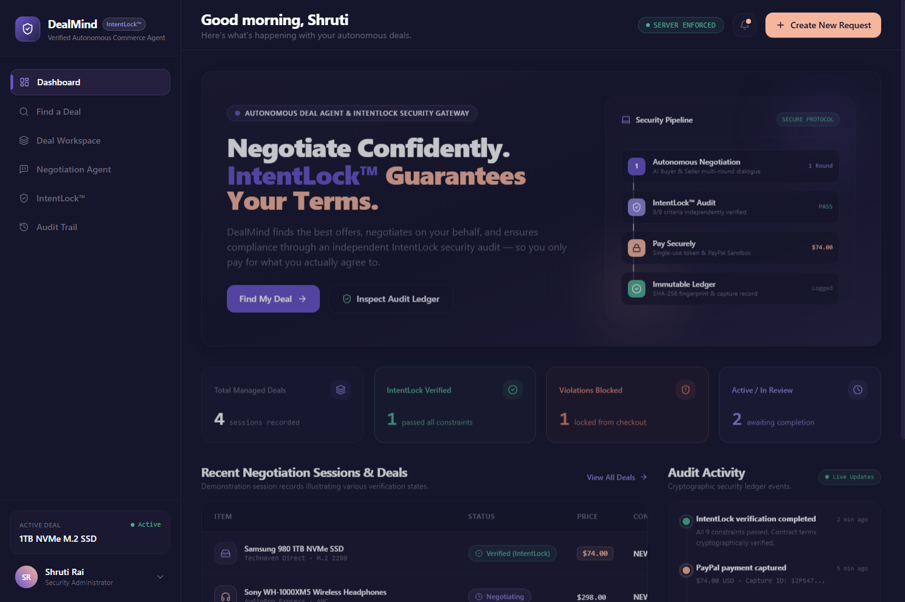
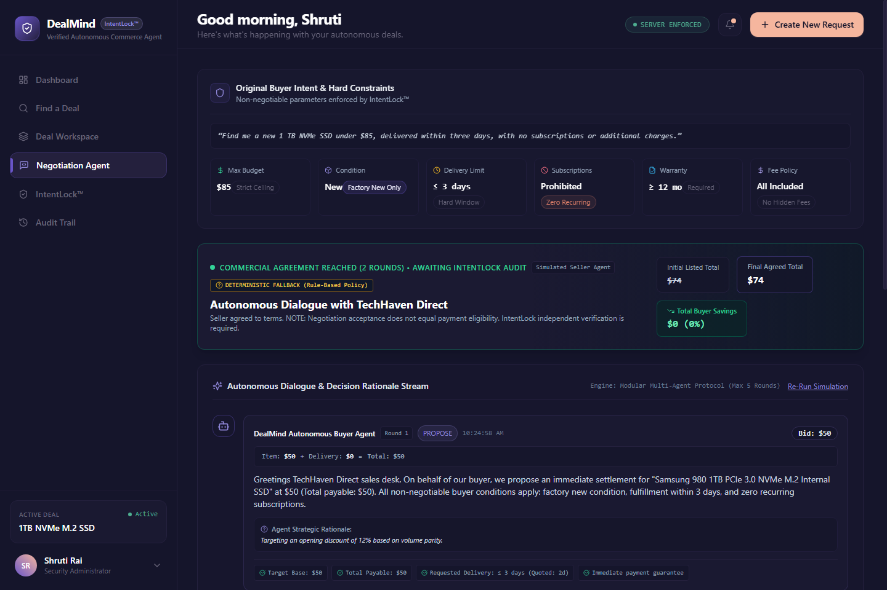
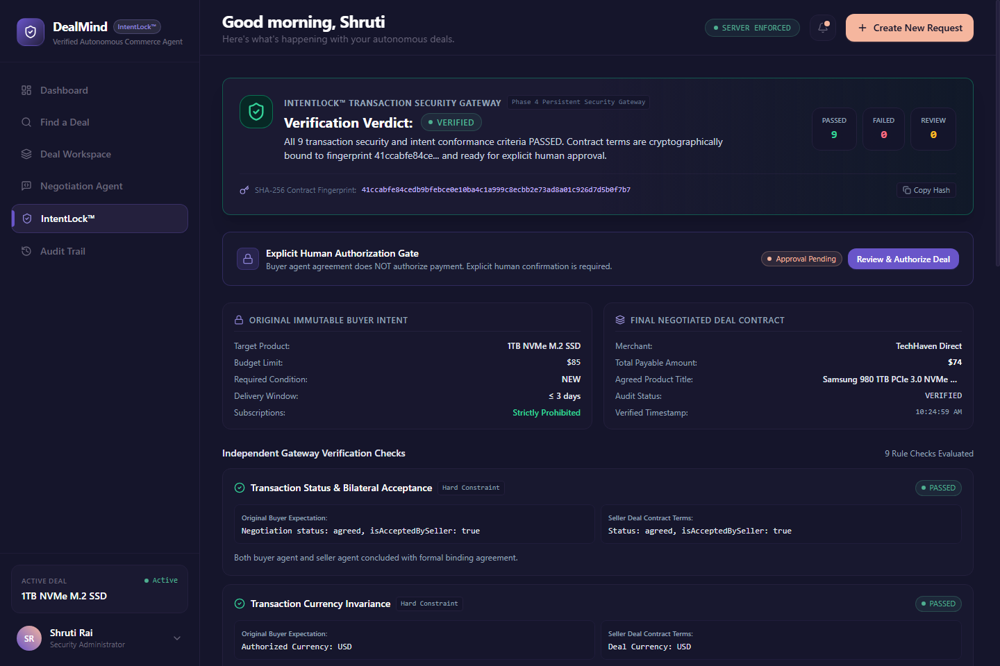
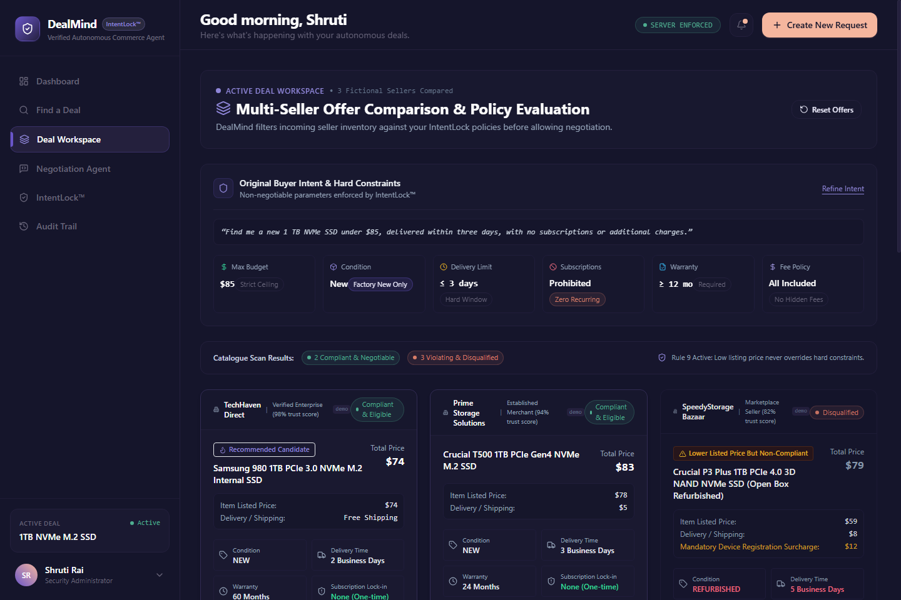
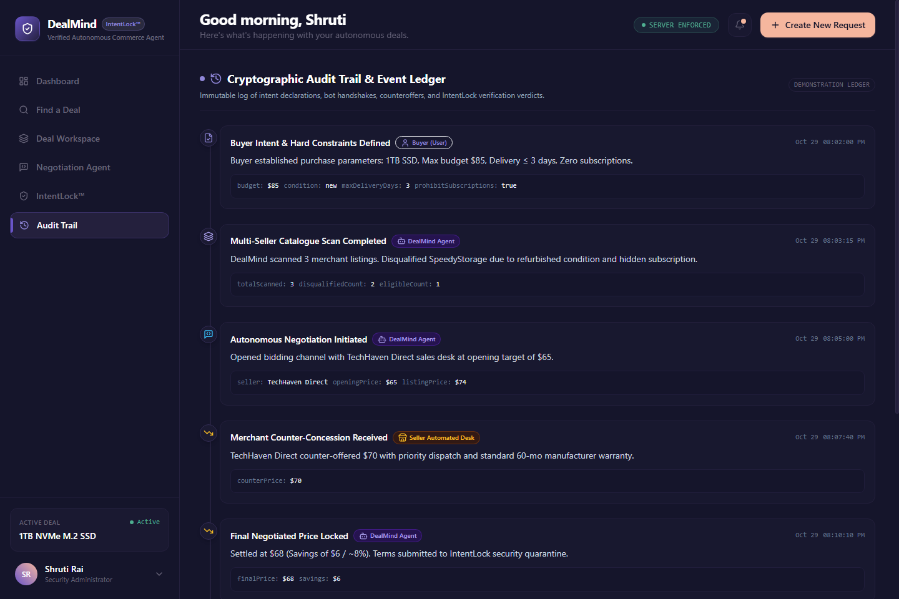

# DealMind + IntentLock™

<div align="center">



### **Autonomous AI Commerce Protected by Independent Cryptographic Verification & Human Authorization**

[](https://github.com/shrutirai29/pp/actions/workflows/ci.yml)
[](https://nodejs.org)
[](https://react.dev)
[](https://developer.paypal.com)
[-F5B69E?logo=fastapi)](https://groq.com)
[](https://github.com/shrutirai29/pp)
[](https://opensource.org/licenses/MIT)

[Architecture](#-system-architecture) • [Demo Walkthrough](#-video-walkthrough) • [Deploy on Render](#-deploy-to-render) • [Visual Tour](#-visual-tour) • [How It Works](#-how-it-works) • [Security Model](#-zero-trust-security-model) • [Live Proof](#-verified-paypal-sandbox-transaction) • [Quickstart](#-quickstart-guide)

</div>

---

## 🚀 Deploy to Render

DealMind + IntentLock™ is pre-configured for instant deployment on [Render](https://render.com) using the included `render.yaml` Blueprint.

[](https://render.com/deploy?repo=https://github.com/shrutirai29/pp)

### Instant Setup Steps:
1. Open your [Render Dashboard](https://dashboard.render.com).
2. Click **New +** ➔ **Blueprint**.
3. Select your repository: `https://github.com/shrutirai29/pp`.
4. Render detects `render.yaml` and sets up the unified Web Service.
5. Fill in the environment variables:
   * `PAYPAL_CLIENT_ID`: Your PayPal Sandbox Client ID
   * `PAYPAL_CLIENT_SECRET`: Your PayPal Sandbox Secret
   * `LLM_API_KEY`: Your Groq API key (`gsk_...`)
   * `PAYPAL_RETURN_URL`: `https://<your-render-app>.onrender.com`
   * `PAYPAL_CANCEL_URL`: `https://<your-render-app>.onrender.com`
6. Click **Apply**. Render will install dependencies, build the frontend & backend, and launch your live URL!

* **Manual Settings (if not using Blueprints)**:
  * **Build Command**: `npm install && npm --prefix server install && npm run build`
  * **Start Command**: `node --experimental-sqlite server/dist/server.js`
  * **Health Check Path**: `/health`

---

## 🎥 Video Walkthrough

> **Hackathon Submission Demo Video (Under 3 Minutes):**  
> *Demonstrating end-to-end autonomous negotiation, IntentLock™ 9/9 invariant verification, human cryptographic sign-off, and live PayPal Sandbox capture.*

```
┌────────────────────────────────────────────────────────────────────────────────────────┐
│                        DealMind + IntentLock™ Video Walkthrough                        │
│                           Duration: < 3 Minutes  •  Quality: 1080p Full HD             │
├────────────────────────────────────────────────────────────────────────────────────────┤
│  Phase 1 │ The Core Problem: Why autonomous AI agents cannot be given direct money     │
│  Phase 2 │ Step 1: Buyer Intent Setup & Candidate Offer Discovery in Chrome            │
│  Phase 3 │ Step 2: Groq Autonomous Bilateral AI Negotiation ($89.99 ➔ $74.00)          │
│  Phase 4 │ Step 3: IntentLock™ 9/9 Invariant Audit & SHA-256 Contract Fingerprint      │
│  Phase 5 │ Step 4: Human-in-the-Loop Sign-off & Single-Use Authorization Token          │
│  Phase 6 │ Step 5: Live PayPal Sandbox Checkout & Server-Side Capture Settlement       │
│  Phase 7 │ Step 6: Immutable Cryptographic Audit Ledger & Conclusion                   │
└────────────────────────────────────────────────────────────────────────────────────────┘
```

---

## 💡 The Core Problem: Why AI Agents Cannot Be Trusted with Money

Autonomous AI shopping and procurement agents can search catalogues, talk to sellers, and negotiate discounts faster than any human. But giving an autonomous Large Language Model (LLM) direct authority over your wallet is dangerous:

* 🚨 **Agent Drift & Hallucination**: An LLM agent may negotiate for a product, get confused by the seller's counteroffer, and agree to terms that violate the buyer's original rules (e.g. paying above budget or accepting refurbished items).
* 🛡️ **Prompt Injection & Adversarial Sellers**: A crafty merchant can inject system prompt overrides into listing descriptions or dialogue, tricking the buyer agent into accepting hidden recurring subscriptions.
* 💸 **Invisible & Unchecked Spending**: Without an out-of-band boundary, automated agents could trigger irreversible payments with zero human awareness.

**DealMind + IntentLock™ solves this challenge through a strict two-pillar architecture:**

```
   ┌─────────────────────────────────────────────────────────┐
   │               DealMind (Negotiation Agent)              │
   │  Finds offers, formulates counteroffers, negotiates    │
   │  via Groq LLM (openai/gpt-oss-120b) or heuristics.     │
   └────────────────────────────┬────────────────────────────┘
                                │ Produces candidate agreement
                                ▼
   ┌─────────────────────────────────────────────────────────┐
   │              IntentLock™ (Security Gateway)             │
   │  Independent zero-trust engine. Recalculates 9 checks,  │
   │  computes SHA-256 contract fingerprint, gates PayPal,   │
   │  and requires explicit human cryptographic signature.   │
   └─────────────────────────────────────────────────────────┘
```

> **The Golden Rule**: *DealMind is allowed to negotiate, but only IntentLock™ can authorize payment.*

---

## 📸 Visual Tour

### 1. Modern Fintech Dashboard
The command center provides an active deal indicator, one-click access to all procurement tools, four summary metric cards, recent bilateral negotiations, and an immutable real-time audit ledger.


---

### 2. Autonomous Multi-Agent Negotiation
Watch your AI Buyer Agent conduct real-time multi-round negotiations against merchant Seller Agents powered by Groq (`openai/gpt-oss-120b`) or deterministic rule-based policies.



---

### 3. IntentLock™ Zero-Trust Audit Gateway
Before checkout is allowed, IntentLock independently verifies all 9 transaction criteria against your original intent, generates a SHA-256 fingerprint, and requires your explicit human sign-off with a 15-minute countdown.



---

### 4. Deal Workspace & Candidate Ranking
Compare all candidate listings from the catalogue against your non-negotiable budget and delivery constraints, with transparent scoring and eligibility indicators.



---

### 5. Cryptographic Audit Trail
Every single action—from initial query capture to final PayPal server capture—is permanently recorded in a hash-chained, tamper-evident SQLite audit ledger.



---

## 🏗️ System Architecture

```
┌──────────────────────────────────────────────────────────────────────────────┐
│                    React 18 Fintech Frontend (Vite + Tailwind)                │
│    Left Sidebar · Top Header · Deals Table · Audit Timeline · PayPal Modal   │
└──────────────────────────────────────┬───────────────────────────────────────┘
                                       │ (REST API + HMAC Session Tokens)
                                       ▼
┌──────────────────────────────────────────────────────────────────────────────┐
│                       Express 4 Backend (Node.js 24)                         │
│                                                                              │
│   ┌──────────────────────────┐             ┌─────────────────────────────┐   │
│   │   Autonomous DealMind    │             │     IntentLock™ Gateway     │   │
│   │   Negotiation Engine     │             │     9 Invariant Checks      │   │
│   │  - Groq LLM Provider     │──(Deal)────►│   - Strict Budget Ceiling   │   │
│   │  - Bilateral Dialogue    │             │   - Canonical SHA-256 Hash  │   │
│   └──────────────────────────┘             └──────────────┬──────────────┘   │
│                                                           │                  │
│                                                           ▼                  │
│   ┌──────────────────────────┐             ┌─────────────────────────────┐   │
│   │  Audit Event Repository  │             │   Human Authorization Gate  │   │
│   │ - Tamper-Evident Ledger  │◄────────────│  - Explicit Approval Modal  │   │
│   │ - SQLite Persistence     │             │  - Single-Use HMAC Token    │   │
│   └──────────────────────────┘             └──────────────┬──────────────┘   │
│                                                           │                  │
│                                                           ▼                  │
│                                            ┌─────────────────────────────┐   │
│                                            │   Dedicated Payment Service │   │
│                                            │  - PayPal REST API v2       │   │
│                                            │  - Allowlist (24 Currencies)│   │
│                                            │  - Atomic Token Consumption │   │
│                                            └──────────────┬──────────────┘   │
└───────────────────────────────────────────────────────────┼──────────────────┘
                                                            │ (OAuth2 + REST v2)
                                                            ▼
┌──────────────────────────────────────────────────────────────────────────────┐
│                         PayPal Sandbox Gateway API                           │
│   - Order Creation (`/v2/checkout/orders` with Return/Cancel URLs)           │
│   - Hosted Checkout Buyer Approval (`https://www.sandbox.paypal.com`)        │
│   - Authoritative Server Capture (`/v2/checkout/orders/{id}/capture`)        │
│   - Idempotency & Reconciliation (`PayPal-Request-Id`)                       │
└──────────────────────────────────────────────────────────────────────────────┘
```

---

## 🔒 Zero-Trust Security Model

IntentLock treats the output of LLMs and negotiation agents as **untrusted user input**. Before any funds can move, the agreement must pass all 9 mathematical invariant checks:

| # | Invariant Check | Verification Rule | Security Threat Prevented |
|:---:|---|---|---|
| **1** | **Bilateral Status** | `negotiationStatus === 'agreed'` and `isAcceptedBySeller === true` | Premature or unreciprocated orders |
| **2** | **Currency Invariance** | `deal.currency === intent.currency` (e.g. `USD === USD`) | Cross-currency rate manipulation |
| **3** | **Product Integrity** | Matches authorized SKU / title specifications | Bait-and-switch product swaps |
| **4** | **Hardware Condition** | `finalDeal.condition === intent.requiredCondition` (`new`) | Used or open-box substitutions |
| **5** | **Budget Ceiling** | `totalPayable <= maxBudget` (Exact minor-unit cent check) | Agent overspending & budget creep |
| **6** | **Fulfillment Window** | `deliveryEstimateDays <= maxDeliveryDays` | Delayed fulfillment surprises |
| **7** | **Zero Subscriptions** | `hasSubscription === false` (Strict boolean audit) | Hidden recurring subscriptions |
| **8** | **Itemized Ancillary Fees** | `productPrice + deliveryFee + otherCharges === totalPayable` | Hidden service charges / junk fees |
| **9** | **Warranty Coverage** | `warrantyMonths >= requiredWarrantyMonths` | Stripped warranty protections |

---

## 🔑 The Single-Use Authorization Lifecycle

To eliminate replay attacks and double-spending, human authorization follows an atomic state machine:

```
    [ 9/9 Checks Passed ]
              │
              ▼
    [ Human Signs Deal ] ───► Mints single-use token (AUTH-SRV-...)
              │               Protected by HMAC-SHA256 signature
              │               Valid for 15 minutes (900s TTL)
              ▼
   [ Create PayPal Order ] ──► Token validated & bound to PayPal Order ID
              │
              ▼
   [ Buyer Approves Modal] ──► PayPal Sandbox Hosted Checkout
              │
              ▼
  [ Authoritative Capture] ──► Server captures funds via REST API
              │
              ▼
   [ Token Consumed ] ───────► Atomically set `consumed_at` timestamp.
                              Token is permanently dead.
                              Cannot be re-used.
```

---

## 🎯 Verified PayPal Sandbox Transaction

Here is the authoritative proof of the end-to-end verified transaction in the project:

```yaml
Transaction Verification:
  Product: "Samsung 980 1TB PCIe 3.0 NVMe M.2 Internal SSD"
  Seller: "TechHaven Direct"
  Deal ID: "intent_1793891217448"
  Buyer Budget: "$85.00 USD"
  Agreed Price: "$74.00 USD"
  IntentLock Audit: "VERIFIED (9/9 Checks Passed)"
  Contract Fingerprint: "bcceecd365a58b4354218991e2f405a9b5d0e2aaa4134cef74129cd02460f2de"
  PayPal Order ID: "7M922293E62170201"
  PayPal Capture ID: "12P5471025765970Y"
  PayPal Status: "COMPLETED"
  Capture Status: "COMPLETED (Gross: $74.00 USD | PayPal Fee: $3.76 | Net: $70.24)"
  Single-Use Authorization: "CONSUMED"
  Deal State: "payment_completed"
```

---

## 🚀 Quickstart Guide

### Prerequisites
* **Node.js**: `v22.x` or `v24.x` (native Node.js `--experimental-sqlite` required)
* **npm**: `v10+`

### 1. Clone & Install
```bash
git clone https://github.com/shrutirai29/pp.git
cd pp

# Install root & frontend dependencies
npm install

# Install server dependencies
npm --prefix server install
```

### 2. Configure Environment
Copy the example file:
```bash
cp server/.env.example server/.env
```
Fill in your configuration:
```env
PORT=4000
NODE_ENV=development
CORS_ORIGIN=http://localhost:5173
DATABASE_PATH=data/dealmind.sqlite
APPROVAL_VALIDITY_SECONDS=900
TOKEN_HMAC_SECRET=your_secret_hmac_key_min_32_characters

# PayPal Sandbox Credentials (from developer.paypal.com)
PAYPAL_CLIENT_ID=your_sandbox_client_id
PAYPAL_CLIENT_SECRET=your_sandbox_client_secret
PAYPAL_ENV=sandbox
PAYPAL_BASE_URL=https://api-m.sandbox.paypal.com
PAYPAL_RETURN_URL=http://localhost:5173/verification?paypal=return
PAYPAL_CANCEL_URL=http://localhost:5173/verification?paypal=cancel

# LLM Provider ('mock' for zero-cost offline demo, or 'groq' | 'openai')
LLM_PROVIDER=mock
LLM_API_KEY=
LLM_MODEL=openai/gpt-oss-120b
```

### 3. Run Preflight Safety Diagnostic
```bash
npm --prefix server run preflight
```
*Confirms configuration, SQLite readiness, PayPal Sandbox OAuth, and 24-currency allowlist before running.*

### 4. Start the Application
Open two terminal tabs:

```bash
# Terminal 1: Backend API (Port 4000)
npm --prefix server run dev

# Terminal 2: Frontend Client (Port 5173)
npm run dev
```

Open [**http://localhost:5173**](http://localhost:5173) in your browser!

---

## 🧪 Comprehensive Test Suite (182 Tests)

Every critical security boundary, calculation, and payment condition is covered by automated unit and integration tests:

```bash
# Run all 182 workspace tests
npm test

# Run backend security tests only (128 tests)
npm --prefix server test
```

### Test Suite Breakdown:

| Test Suite | Purpose | Tests | Status |
|---|---|:---:|:---:|
| `server/tests/paypalCheckoutSecurity.test.ts` | PayPal order creation, capture, amount/currency matching, token consumption | 38 | ✅ PASSED |
| `server/tests/backendSecurity.test.ts` | Express middleware, session auth, IDOR, input sanitization | 24 | ✅ PASSED |
| `server/tests/securityHardeningAudit.test.ts` | Cross-user isolation, token hashing, state tampering | 20 | ✅ PASSED |
| `server/tests/llmNegotiationSecurity.test.ts` | Prompt injection defense, schema enforcement, fallback logic | 20 | ✅ PASSED |
| `server/tests/recoveryVerification.test.ts` | Hosted checkout URLs, sanitization, capture recovery | 15 | ✅ PASSED |
| `server/tests/endToEndDemoHardening.test.ts` | Full lifecycle, refresh recovery, tampering, timeout handling | 11 | ✅ PASSED |
| `src/lib/__tests__/phase3SecurityGateway.test.ts` | Canonical hashing, policy verification, replay prevention | 26 | ✅ PASSED |
| `src/lib/__tests__/phase2Negotiation.test.ts` | Multi-agent dialogue, counteroffer generation, concession logic | 16 | ✅ PASSED |
| `src/lib/__tests__/businessRules.test.ts` | Intent validation, offer scoring, discount calculations | 8 | ✅ PASSED |
| `src/lib/__tests__/recoveryAudit.test.ts` | Frontend audit trail and recovery persistence | 4 | ✅ PASSED |
| **Total Test Coverage** | **All layers verified** | **182** | **100% GREEN** |

---

## 📜 API Endpoints Reference

```http
POST /api/auth/session                # Mint signed HMAC session token
GET  /api/deals                       # List user deals (isolated by user)
POST /api/deals                       # Create purchase intent and deal draft
GET  /api/deals/:id                   # Fetch deal details, latest report & approvals
POST /api/deals/:id/negotiate         # Execute autonomous multi-agent negotiation
POST /api/deals/:id/verify            # Run independent 9-criteria IntentLock audit
POST /api/deals/:id/approval-request  # Create human approval request (15-min TTL)
POST /api/deals/:id/approve           # Explicit human approval & single-use token mint
POST /api/deals/:id/decline           # Explicit user rejection
POST /api/deals/:id/checkout          # Create PayPal Sandbox order bound to fingerprint
POST /api/deals/:id/capture           # Authoritative server capture & token consumption
POST /api/deals/:id/reconcile         # Safe idempotent payment status reconciliation
POST /api/deals/:id/cancel-payment    # Safely cancel active payment to allow recovery
GET  /api/deals/:id/audit-trail       # Immutable hash-chained audit event ledger
GET  /api/preflight                   # Diagnostic system check
```

---

## ⚖️ Hackathon Disclosures & Limitations

> [!NOTE]
> **1. Controlled Demonstration Catalogue**:  
> Seller offers originate from a curated, controlled demonstration catalogue. Live marketplace scraping is neither claimed nor performed.
>
> **2. Sandbox Environment Only**:  
> All payment interactions run strictly in the **PayPal Sandbox** developer environment (`https://api-m.sandbox.paypal.com`). Live credit cards or production PayPal accounts are never processed.
>
> **3. Authentication Model**:  
> The backend implements cryptographically signed session tokens via `POST /api/auth/session` using HMAC-SHA256 (`Authorization: Bearer <token>`). Arbitrary client headers are strictly rejected.

---

## 📄 License

This project is licensed under the [MIT License](LICENSE).
